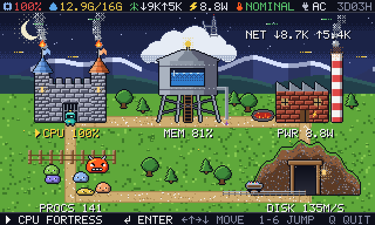

# macos-perf-bros

A terminal system monitor for Apple Silicon Macs, presented as an original NES-style platformer. Walk a little robot around an overworld of zones (CPU Fortress, Memory Reservoir, Network Sky, Disk Mines, Process Plains, Power Plant) and enter one to see that subsystem as a level, where every sprite encodes a live metric.



## Quick start

```bash
bun install
bun start                 # live; asks for sudo once so powermetrics can run (the UI itself never runs as root)
bun start -- --no-sudo    # live without sudo (no GPU/power/thermal/frequencies)
bun run demo              # replay bundled recordings, no sudo needed
```

The best way to view it is Ghostty, Kitty or WezTerm, which get real pixel graphics (320×192). Other terminals get a half-block version. Needs at least 80×24.

Keys: arrows or `hjkl` move · `⏎` enter · `Esc` back · `1`–`6` jump to a zone · `r` toggle renderer · `q` quit.

## Docs

- [DESIGN.md](DESIGN.md): product and architecture
- [AGENTS.md](AGENTS.md): rules for contributors and coding agents
- [docs/ART_DIRECTION.md](docs/ART_DIRECTION.md): visual style guide
- [docs/ROADMAP.md](docs/ROADMAP.md): what's next, as self-contained tasks
- [fixtures/README.md](fixtures/README.md): data-source quirks
